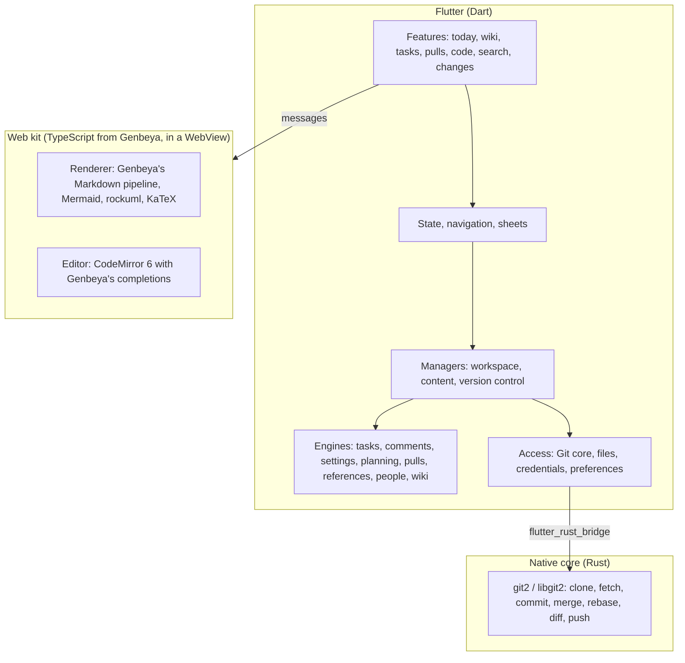
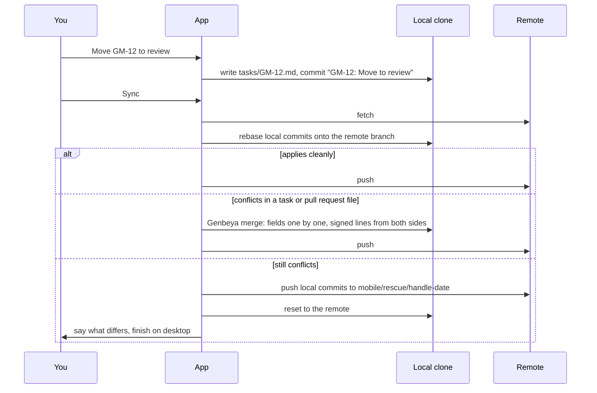

# Architecture

How the app is put together, and how it stays in step with Genbeya desktop while the two codebases are separate. Decisions marked **Spike** are made in milestone M0 ([[Roadmap]]). [[Call chains]] follows each user story through these layers, call by call, and checks the design for scale and for harm.

[TOC]

## Overview

The desktop app's layering by volatility carries over ([Architecture](https://github.com/genbeya/genbeya/blob/develop/docs/Architecture.md)): each layer hides one thing that is likely to change, and calls only go down.



| Layer | Folder | Hides | Notes |
| --- | --- | --- | --- |
| Contracts | `lib/contracts/` | Nothing: the model types (`Task`, `Settings`, `WikiNode`, `Pull`, …) | Mirror `src/contracts/model.ts`, same names and JSON shape |
| Engines | `lib/engines/` | The rules for the file formats | Pure Dart, no I/O; ported from Genbeya and checked against it ([Conformance](#conformance)) |
| Access | `lib/access/` | How Git is called, where files and secrets are kept | Git through the native core; files through `dart:io` |
| Managers | `lib/managers/` | The use cases: open, save a task, comment, sync | Named after the desktop's managers and their calls, so a desktop change points at its mobile counterpart |
| Features | `lib/features/` | The user interface | Flutter widgets; state with Riverpod, routes with go_router |
| Web kit | `kit/` | Rendering and editing Markdown and code | Built from Genbeya's own sources, see below |
| Native core | `native/` | libgit2, and later rockuml | A Rust crate, bound with flutter_rust_bridge |

## Git on the device

Mobile platforms have no `git` command, and iOS can't run one. Desktop Genbeya speaks Git's command line, so this is the one part that is truly new.

| Option | Clone, fetch, push | Merge, rebase, diff | Android and iOS | Verdict |
| --- | --- | --- | --- | --- |
| **Rust core with `git2` (libgit2)** through flutter_rust_bridge | Yes, HTTPS and SSH | Yes, with options close to Git's (indent heuristic, rename detection) | Cross-compiles with vendored libgit2, OpenSSL and libssh2; GitSync is a Flutter app on this stack | **Decided** ([[Decisions]]). The Tauri shell is already Rust, and rockuml can join the same crate later |
| `git2dart` (libgit2 over Dart FFI) | Yes | Yes | Prebuilt binaries for Android and iOS | The fallback, if the Rust core doesn't clone, commit and push on both platforms within two days of the spike |
| gitoxide (`gix`) | Clone and fetch; push not finished | Partly | Pure Rust, easy to build | Not yet |
| Pure-Dart Git | Partial | Little | Yes | Too incomplete |
| Forge APIs only (GitHub, GitLab REST) | Through the API | Through the API | Yes | Breaks "any Git host" and offline; not the core, maybe a later "quick look without cloning" |

**Spike** ([[GM-2]]): clone, edit, commit, fetch, rebase and push over HTTPS and SSH on a real Android phone and an iPhone, with a shallow clone, before anything else is built on it.

**Result** (on Linux, phones pending): `native/genbeya_core` (git2 0.21, vendored libgit2 1.9.7, OpenSSL and libssh2), bound with flutter_rust_bridge 2.13.0 and built by cargokit into the Android app, does all of the above, including the in-memory rebase and commits onto another branch without a checkout. About 7 MB per Android ABI in release; the iOS build passes in CI too, unsigned. The Rust core stays; `git2dart` isn't needed. See `native/genbeya_core/README.md`.

The native core exposes a small, task-shaped API rather than libgit2 itself: `clone`, `fetch`, `status`, `commitFiles` (write a commit from changed paths, optionally onto another branch's tree without a checkout), `rebaseOnto`, `push`, `log` (with paths, for activity and plan history), `diff` (merge base to head, for pull requests), `mergeTree` (would it conflict), `readBlob` (a file at a revision).

### Clones on a phone

- **Shallow, single branch** by default (the newest 200 commits), plus the content branch if a remote has one. **Activity**, **Burndown** and **Baseline** deepen the clone on demand and say so while they do.
- **Storage** per repository is shown on the start screen, with **Remove clone**.
- **The content branch** needs no worktree on the device: its areas are read from the branch's tree and edits are committed straight onto it, which libgit2 does without a checkout. `.genbeya-content` decides the layout as on desktop ([Content branch](https://github.com/genbeya/genbeya/blob/develop/docs/Architecture/Content-branch.md)).

## Where edits go



- The target branch is the content branch for its areas, else the checked-out branch, moved to `mobile/<handle>` when the host refuses a push; see [[Experience#sync-and-changes]].
- The Genbeya merge for task and pull request files is an engine of its own ([[GM-11]]): three-way per frontmatter key; for `## Comments`, `## Time log`, replies and verdicts, both sides' new lines in time order. It only acts where the formats were designed to merge, and gives up otherwise.
- Pushes go through a queue: one sync at a time per repository, as the desktop's serial queue does.

## The web kit

Genbeya renders Markdown with a pipeline of about 5,000 lines (`src/client/app/markdown/`: references, embeds, mentions, dates, callouts, math, diagrams, plan macros) on top of unified and remark, draws Mermaid, PlantUML through rockuml's WebAssembly, and KaTeX. Porting that to Dart would be the largest and most fragile part of the work, and every desktop change would have to be redone.

The VS Code extension already solved the same problem: its webviews (`src/shells/vscode/webview/`) render pages and tasks with the client's pipeline, outside Angular, and talk to the host only through messages (`protocol.ts`): the host sends a document and a `MarkdownContext` (wiki tree, task titles and states, people, settings, plan tasks); the webview reports followed links, checkbox toggles and requests for images and files. **The mobile app is another host for that protocol.**

- **The kit** is a small bundle built from a pinned Genbeya commit: the VS Code webview's Markdown renderer and its message protocol, plus a CodeMirror 6 editor with Genbeya's Markdown language and the `[[`, `@` and `//` completions (`references.ts`, `mention-suggestions.ts`, `smart-dates.ts`). `tool/build_kit` checks out Genbeya at the ref in `kit/GENBEYA_REF`, builds, and copies the result into `kit/dist/`, which CI builds before the app (18 MB, so not committed; see `kit/README.md`). Once Genbeya builds the kit itself ([[Kit build]]), `tool/build_kit` downloads the pinned release's bundle and checks it against its manifest instead ([[GM-25]]); until then it builds the same bundle from source, so the app doesn't wait.
- **The WebView** is Flutter's own `webview_flutter`: the long-standing alternative, flutter_inappwebview, has had no stable release since 2024. Web views load ES modules and WebAssembly only from an origin, so the app serves the kit from a small server on the phone's loopback interface (`lib/access/kit/kit_server.dart`): `127.0.0.1`, a random port, a random first path segment, only the kit's own files and `host.js`, the host's side of the channel, with the desktop's content security policy as a header too. Repository content never goes through the server: pages, images and files travel as messages, which the host checks (`lib/access/kit/kit_protocol.dart`). Android allows plain HTTP to `127.0.0.1` only; iOS allows local networking. Markdown never becomes HTML; the allowlisted DOM builder is the same code.
- **Native around it**: titles, chips, sheets, lists and the board are Flutter. The WebView renders the body of a page, a task's description and comments, a pull request's file, and hosts the editors. It reports its height so it scrolls with the native parts around it.
- **Theme**: the app's colours are passed in as the kit's tokens, light and dark.

**Spike** ([[GM-3]], [[GM-4]]): render this wiki and Genbeya's own `docs/` (references, Mermaid, PlantUML, math, `[GANTT]`) on both platforms offline; and compare editing a long Markdown file in CodeMirror 6 in the WebView with a native Flutter editor (re_editor) for typing, selection handles, autocorrect and scrolling on real devices. CodeMirror 6 is the expected winner (built for touch, the desktop's editor, completions for free); if it loses, the code editor goes native and only Markdown stays in the kit. **Decided** ([[Decisions]]): CodeMirror 6 for pages and code, one WebView kept warm; comments use a native text field with the app's pickers.

## Engines

What the app decides itself is ported to Dart, small and pure as on desktop:

| Engine | From Genbeya | Does |
| --- | --- | --- |
| Settings | `settings-engine.ts` | Reads `.genbeya.yml` with its defaults and validation; edits keep comments (yaml_edit) |
| Tasks | `task-engine.ts`, `text-style.ts` | Parses task files; changes a field without touching the others, their order, YAML comments, line endings or BOM; creates tasks with the next ID and templates |
| Comments and signed lines | `task-comments.ts`, the time log in `planning.ts` | Reads, appends, edits comments and time log lines; flags lines it can't read |
| Planning | `planning.ts` | Effort, the five numbers, blocked and ready, critical path and float for the task screen and cards |
| Pull requests | `pull-requests.ts`, `pull-engine.ts` | Topics, code ranges, replies, verdicts, to-dos, effective approvals, ready to merge, the change ID |
| References and links | `utilities/references.ts`, `genbeya-link.ts`, `remote-url.ts` | Resolving `[[…]]`, strict `genbeya://` parsing, web links per forge |
| People | `people-engine.ts`, `utilities/people.ts` | Handles, aliases, "me" |
| Wiki | `wiki-engine.ts` | The page tree and titles from file names |
| Activity | `task-activity.ts` | Field changes between versions of a task |
| Sample | `sample-engine.ts` | The sample project's files and commits, for **Try the sample project** ([[GM-27]]) |
| Search | `search-engine.ts` | Results and excerpts, over the files with Dart's regular expressions, in an isolate |

Plan macros need no Dart port: the kit computes them from the tasks it is given, with the desktop's own `planning.ts` and `plan-history.ts`.

## Repository state

The desktop polls a snapshot every four seconds, because other programs change its files too. On the phone the clone lives in the app's private storage and the app is its only writer, so the state is event-driven instead: the app's own writes update an in-memory model, a sync reparses only the paths that changed between the old and the new HEAD, and parsed files are cached by blob ID. See [[Call chains#the-repository-model]]; it holds only while clones stay private to the app.

## Conformance

Two codebases drift unless something notices. Every engine is checked against Genbeya itself:

- `tool/conformance/` holds fixture repositories and edits (change a status in a file with YAML comments and CRLF, append a comment, log time, add a verdict, parse a broken time log line, compute float, compute a change ID, …).
- A Node script imports Genbeya's engines from the pinned checkout, runs each case and writes the expected results as JSON.
- Dart tests run the same cases through the ported engines and compare, byte for byte for files.
- CI runs it against the pinned ref on every push, and nightly against Genbeya's `develop`, so a desktop change that the mobile app doesn't follow yet shows up as a failing case, not as a corrupted file in someone's repository.

The rule that follows: the app writes nothing that conformance doesn't cover.

## Security

The same stance as the desktop ([Security](https://github.com/genbeya/genbeya/blob/develop/docs/Architecture/Security.md)): repositories are untrusted content.

- The kit runs with the desktop's content security policy, no network, and only the message protocol to reach the app. Links open in the system browser for `http`, `https` and `mailto` only.
- Every path a message names is checked with the desktop's path rules before a file is read.
- Credentials live in the system keychain, never in the clone's config or in links.
- SSH host keys are pinned on first use, with the fingerprint shown.
- Git runs no hooks (libgit2 has none) and no filters from the repository.

## Repository layout

```text
lib/
  contracts/  engines/  access/  managers/  features/  app.dart
kit/
  GENBEYA_REF  dist/  src/        # the kit's entry points, importing Genbeya's sources
native/
  genbeya_core/                   # Rust crate: git2, later rockuml
tool/
  build_kit  conformance/
test/  integration_test/
docs/  tasks/  .genbeya.yml       # this wiki and board
```

## Changes upstream that would help

None are needed for the trial; each makes an official client cheaper. The first two are specified in [[Upstream]]:

- A `build:kit` target in Genbeya that builds the VS Code webview renderer and the editor as one browser bundle, carried by each release, so the mobile repository doesn't need its own build of Genbeya's sources ([[GM-25]]).
- Screenshots in tasks and pull requests, a convention Genbeya defines and the mobile app follows at release ([[GM-26]]).
- Conformance cases kept in Genbeya, next to the engines' specs, as JSON any client can run.
- A short page of the file formats' grammar (signed lines, verdicts, time log), which the design pages already ask for.
