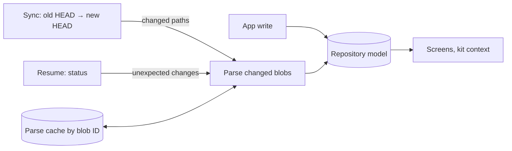
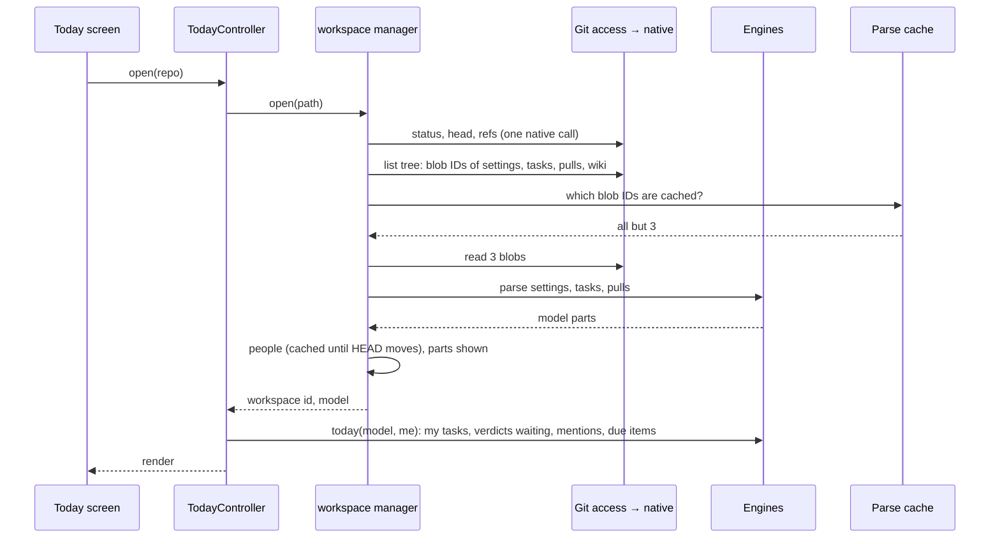
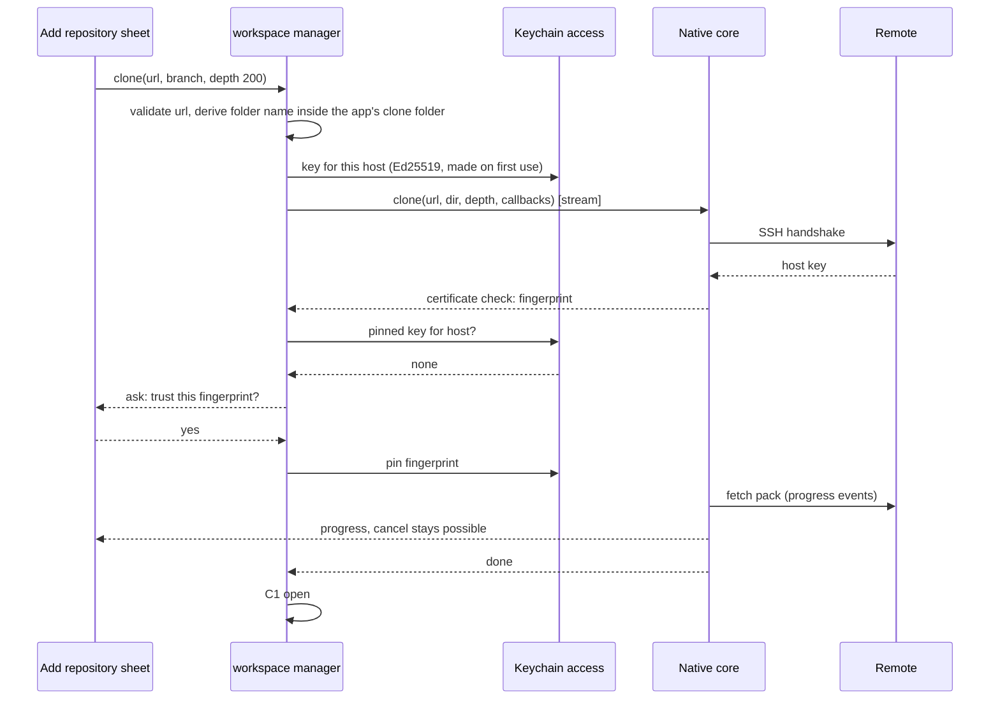
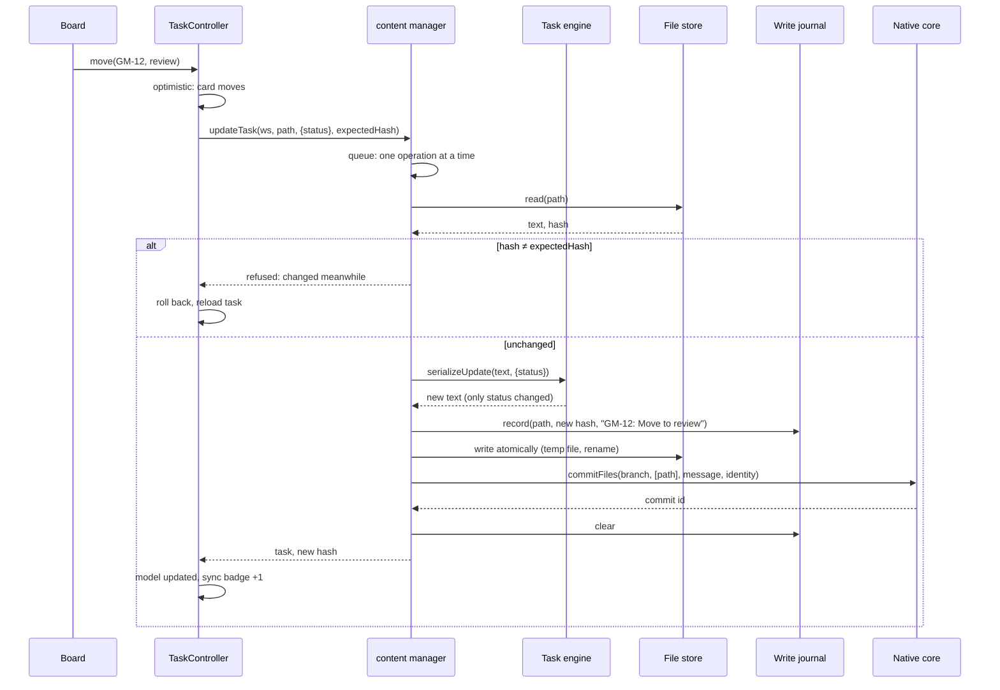
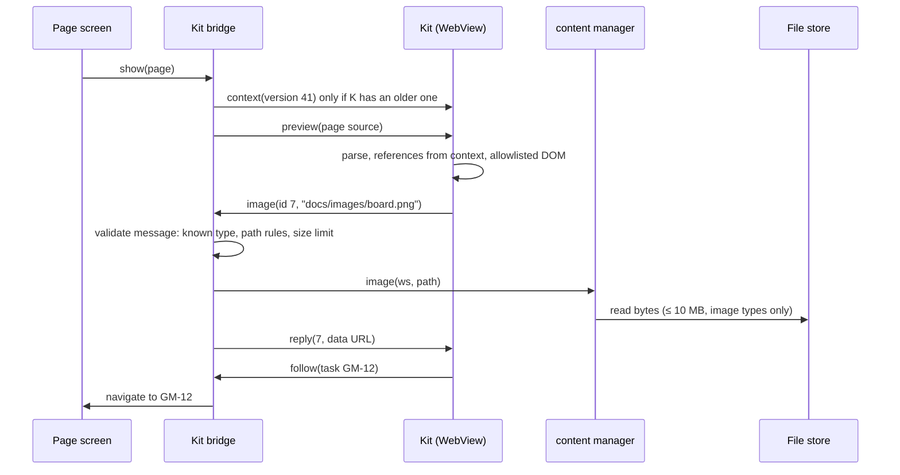
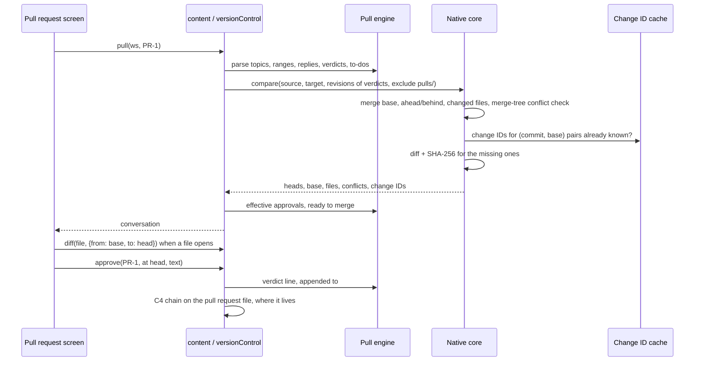
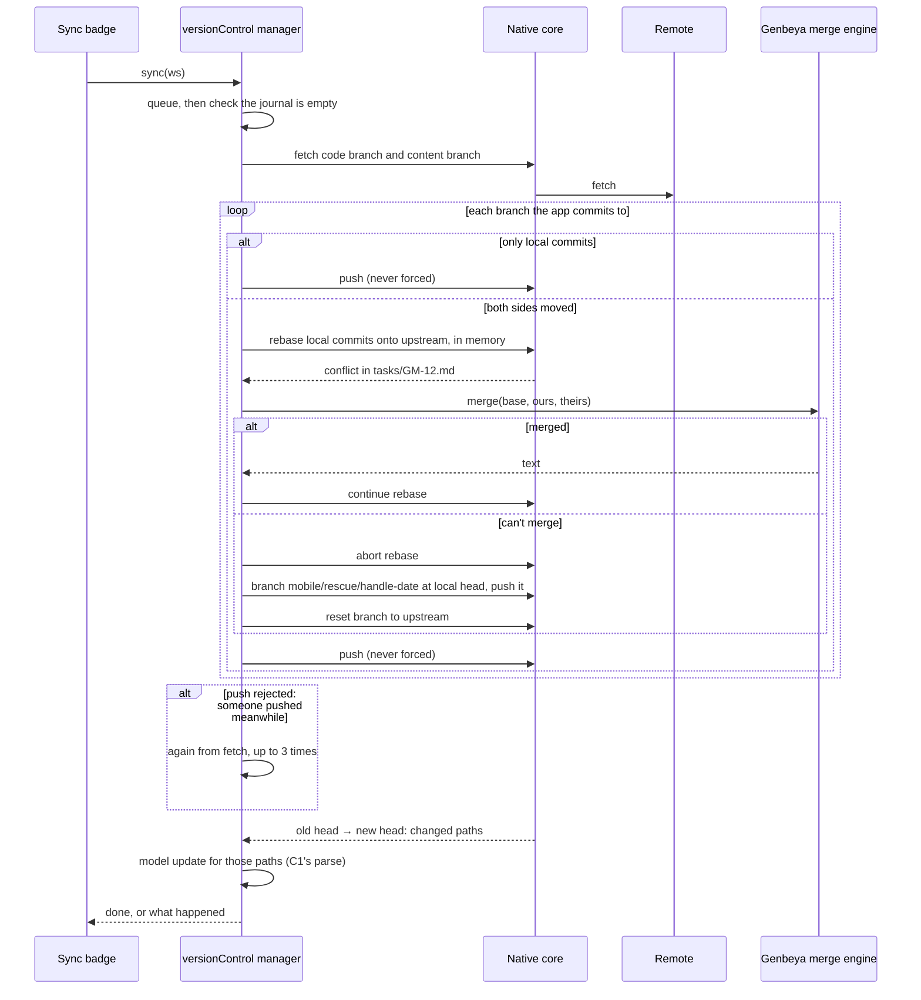

# Call chains

How the [[User stories]] travel through the layers of [[Architecture]], call by call, to check two things before anything is built: that the design still holds when repositories, teams and features grow, and that no chain can lose work, corrupt a file, leak a secret or let a repository harm the phone. The findings at the end change the plan; the tasks named there carry them.

Call names follow the desktop's managers ([Managers](https://github.com/genbeya/genbeya/blob/develop/docs/Architecture/Managers.md)) wherever the mobile app does the same thing, so a desktop change points at its mobile counterpart.

[TOC]

## The layers in a chain

| Layer | In a chain | Rules every chain keeps |
| --- | --- | --- |
| **Screen** | A Flutter widget | Shows the model, sends intents; never reads files |
| **Controller** | A Riverpod notifier per screen or flow | Optimistic UI only for writes that can't conflict; rolls back on refusal |
| **Manager** | `workspace`, `content`, `versionControl` in Dart | Every call names its workspace; one operation at a time per workspace (a serial queue, as on desktop); arguments checked again; no Flutter imports |
| **Engine** | Pure Dart functions | No I/O; byte-for-byte conformance with Genbeya |
| **Access** | File store, Git access, keychain, drafts, preferences | Paths validated with the desktop's rules; no symbolic links followed; writes atomic |
| **Native core** | Rust with `git2`, through flutter_rust_bridge | Async: never on the UI thread; progress as a stream; cancellable |
| **Kit** | Genbeya's renderer and editor in a WebView | Renders and reports; every message it sends is untrusted input |

## The repository model

Every chain below reads from one in-memory **repository model** per open repository: settings, the wiki tree, tasks, pull requests, people, branch state. The desktop builds the same picture from a snapshot it polls every four seconds, because other programs change the files too. On the phone, the clone lives in the app's private storage, so **the app is the only writer**. That allows an event-driven model:

- **Writes made by the app** update the model directly with what was written.
- **A sync** knows HEAD before and after; the native core diffs the two trees and returns exactly the paths that changed. Only those are read and parsed again.
- **Parsed files are cached by blob ID** (Git's hash of the content): a task whose blob didn't change is never parsed twice, also across app starts.
- **On resume**, a cheap `status` checks that nothing outside the app touched the working tree (a crash, a restored backup); if something did, the changed paths are reparsed.

This replaces the desktop's polling with work proportional to what changed, which is what makes large repositories affordable on a phone (see [Scaling](#scaling)). It holds only while clones stay private to the app, as decided ([[Decisions]]): exposing them to the Files app or another editor would bring back polling.

## C1 · Open a repository and show Today

Stories: US-4, US-8, and every screen's first paint.

- **Cost:** one native call for status and refs, one tree listing, then only blobs not in the cache. A warm start reads nothing but the tree.
- **Areas nobody shows** (`unused`, hidden parts) aren't parsed, as `snapshot(…, skip)` does on desktop; the task index still comes from file names, so references resolve.
- **Mentions** for Today come from the search index of C9, limited to the last 30 days of changed files, not from a full scan.

## C2 · Clone over SSH

Stories: US-1, US-3.

- **Credentials** are looked up by host, and the callback hands them only to that host; a redirect to another host gets none. Tokens and keys never enter `.git/config`, the remote URL or a Genbeya link.
- **Cancel, a full disk or a dropped connection** delete the partial clone folder; nothing half-cloned shows up in the list.
- **Folder names** come from the URL, sanitised, inside the app's clone folder; a URL can't name a path.
- **On mobile data**, a clone shows its size so far and can be paused; a first clone over mobile data asks first.

## C3 · Open a Genbeya link

Story: US-2.

1. The operating system delivers `genbeya://open?…` → `LinkController`.
2. The link engine parses it with the desktop's strict rules (`genbeya-link.ts`): known keys once each, a remote on another machine, IDs and commit hashes of a fixed form, paths that pass the path rules. Anything else is refused with the reason.
3. `workspace.findByRemote(normalised remote)` looks through the clones.
4. Found: navigate to the item, on the branch that is checked out. Not found: show **Clone** with the URL filled in; nothing happens until the user taps it (C2).

A link only ever navigates. It never writes, syncs, switches branches or clones by itself.

## C4 · Change a task

Stories: US-9, US-10, US-14, and US-13 with one more field.

- **The journal** closes the gap between writing the file and committing it: if the app is killed in between, the next start finds the journal entry, sees the file differs from HEAD, and commits it with the recorded message. A write is never left uncommitted and forgotten.
- **Bytes:** only the task engine produces file text, and conformance covers every kind of change it makes.
- **Comments** (`addComment`) need no expected hash, as on desktop: they only ever go last. Editing or deleting one names it by index in a version, and is refused once the file changed.
- **New tasks** take the next free ID over every task file, in every epic and on the content branch; a collision with a teammate's new task is handled at sync time (C10).

## C5 · Render a page

Stories: US-5, US-6, US-7, US-26.

- **The context** (wiki tree, task titles and states, files, people, settings, plan tasks) is sent in parts, each with its own version, and only the parts that changed: 3,000 tasks are about 300 KB and 20,000 file paths more, fine once and wasteful per edit. The VS Code protocol sends it with each preview; the kit's protocol splits it ([[Kit build]]).
- **Messages from the kit are untrusted:** a page is repository content, and a bug in a renderer must not turn into a write. The bridge accepts only the known message types, checks every path, caps sizes, and answers file and image requests read-only.
- **The one write the kit can ask for** is ticking a checkbox. The message carries the page's version and the offset; the bridge checks that the version is current and that a checkbox stands at that offset, then runs C4's chain for the page. Anything else is ignored.
- **Plan macros** are computed in the kit from `context.plan`. `[BURNDOWN]` and `[BASELINE]` ask for `planHistory`, which reads at most 300 commits of the task folder; when the clone is shallower, the bridge asks the user before it deepens the clone over the network.
- **Diagrams and math** run in the WebView's own process, with a time limit per diagram; one that is too large shows a message instead of hanging the page.

## C6 · Edit a page

Stories: US-15, US-16, US-18.

1. **Edit** → the kit's editor gets the page text and its hash.
2. Typing `[[`, `@` or `//` → the kit completes from the context it already has, as VS Code's webview does: no round trip per keystroke ([[Kit build]]).
3. Every few seconds, and when the app goes to the background, the kit sends `draft(text)` → the drafts store keeps it in app storage, outside the repository, keyed by path and base hash.
4. **Save** → `content.write(ws, path, text, expectedHash)` → C4's chain: queue, hash check, atomic write with the file's line endings and byte order mark, journal, commit.
5. On reopening, a draft whose base hash still matches is offered back; one whose page changed meanwhile is offered next to the current text, never written over it.
6. **Photo** → the phone shrinks the image to 1600 pixels and strips its location and camera metadata before anything is written, shows its size, then writes it to the wiki's `images/` folder and its reference into the page, in one commit (C4's chain, [[Attached images]]).

## C7 · Log time

Story: US-13. C4's chain with one engine call doing both parts: `addTimeEntry(body, entry)` appends the line to `## Time log` and the update sets `remaining`, so the file changes once and the commit holds both. The entry's name is the repository's Git name; its date is today in the phone's time zone.

## C8 · Review a pull request

Stories: US-19, US-20, US-21.

- **Change IDs are cached forever** by the pair of commit and merge base: both are immutable, so a pull request with many verdicts costs one diff per new revision, not per view.
- **Diffs are lazy**, one file at a time, with large files shown only on request.
- **Where the reply is committed** depends on where pull requests live. On the content branch, the commit goes onto it (C10). In the checkout, the file sits on the source branch: the native core can commit onto that branch's tree without switching to it, and the next sync pushes it there, which is what the desktop's reviewers do after switching. The screen names the branch the reply goes to. The trial does this, only for branches the remote has, and never forced (decided, [[Decisions]]).
- **Verdicts are recorded, not verified**, as on desktop: the screen shows who committed a verdict when it differs from the name in it.

## C9 · Search

Story: US-5, and mentions for C1.

1. Typing → `SearchController`, debounced by 150 ms. Titles and IDs are matched in the model at once.
2. Full text → `content.search(ws, text, options)` → a background isolate walks the files from the tree listing (tracked, plus untracked ones the app wrote), skips binary files and files over 1 MB, and matches with Dart's regular expressions.
3. The desktop's limits apply: text up to 200 characters, no line breaks, 30 files per area, 10 matches per file, lines shortened around the match. A new keystroke cancels the running search; a search over 10 seconds stops with what it found.
4. With a content branch, pages and tasks come from its blobs, code from the checkout, so nothing is listed twice.

A large code repository makes a full scan slow; titles stay instant, and a word index kept beside the parse cache is the step after the trial if the measurements ask for it.

## C10 · Sync

Stories: US-8, US-22, US-23, US-24, US-25.

- **The rebase runs in memory** (libgit2's in-memory rebase): the working tree changes only once the result is known, so a stopped sync leaves the checkout as it was.
- **Nothing is ever forced.** The app has no force push at all; a rejected push means fetch and try again.
- **Nothing is ever discarded.** The rescue branch, `mobile/rescue/<handle>-<date>`, keeps the local commits before the reset and is pushed (offline, with the next sync); a banner stays until its commits are upstream, then the app offers to delete it.
- **Task ID collisions:** two people offline both create `GM-25` in the same place. Git sees two different files added at one path; the Genbeya merge can't merge two tasks. Since the local `GM-25` isn't pushed yet, the app renumbers it to the next free ID in its own commits, rewrites references to it in the files those commits changed, and says "your GM-25 is now GM-26". A collision in different epics (two files, one ID) is found the same way, by ID rather than by path.
- **The content branch** is a second branch in the loop; its commits never touch the working tree.
- **`mobile/<handle>`** joins the loop once a push to the checked-out branch was refused and the user moved the commits there; it is pushed to its own name.

## C11 · Capture from another app

Story: US-11.

1. The share sheet starts the app, possibly cold, possibly with another repository open → `CaptureController` with the shared text.
2. Choose the repository (the last one first), type and epic; the type's template fills the description, the shared text goes below it.
3. `content.createTask(ws, input)` → the task engine takes the next free ID → C4's chain from the atomic write on.

Shared text is data: it is written into the description as Markdown text and never interpreted as a command or a link to follow.

## C12 · A repository that wants to do harm

Story: US-26. Not one chain but what every chain refuses:

| A repository tries | Where it is stopped |
| --- | --- |
| Scripts or remote content in a page | The kit: no raw HTML beyond the desktop's allowlist, a content security policy without network, diagrams as images |
| A message from a compromised renderer | The bridge (C5): known messages only, read-only except a checked checkbox |
| Paths out of the repository (`../`, `.git/…`, absolute) | The file store's path rules, the same as the desktop's |
| Symbolic links to files outside | Checked out as plain files (`core.symlinks=false`); the file store never follows links |
| Programs run on checkout or sync | libgit2 runs no hooks and only built-in filters; `.gitattributes` can't name a program |
| Submodules and Git LFS | Not fetched; LFS pointer files show as text |
| Huge files or a huge history | Shallow clones, size caps on reads (2 MB text, 10 MB images), size shown before deepening |
| A `.genbeya.yml` with huge lists | The settings engine's limits (500 people, 100 milestones, …), as on desktop |
| A regular expression or diagram that never ends | The search isolate's time limit, the diagram time limit, both in other processes or isolates than the UI |
| Links to other schemes | Only `http`, `https` and `mailto`, through the system browser |

## Scaling

What grows, and what each chain costs as it does. The reference size is the one the desktop measured: 3,000 tasks and 1,500 pages.

| What grows | Where it hurts | What keeps it in bounds |
| --- | --- | --- |
| Tasks, pages, pull requests | Parsing on open (C1), the kit's context (C5) | Parse cache by blob ID; areas nobody shows aren't parsed; context once per version |
| Files in the repository | The tree listing, search (C9) | One native listing; search in an isolate with limits; a word index later if needed |
| History | Activity, burndown, baselines | Shallow clones deepened on request; 100 commits per task, 300 for plans, as on desktop |
| People | Mentions, assignees | People cached until HEAD moves; the picker answers 20 matches |
| Verdicts and revisions | Change IDs (C8) | Cached forever by immutable commit pairs |
| Teammates pushing at once | Sync (C10) | Rebase in memory, the Genbeya merge, retry, rescue |
| Repositories on the phone | Storage, memory | One model in memory per open repository; others closed; size per clone shown |
| Phones on mobile data | Data use, battery | Fetches only on sync; deepening and first clones ask first; no polling |

### Features the design should not block

- **Background sync.** Managers don't import Flutter, so they can run where Android's WorkManager or iOS's background tasks start them. Two isolates must then never work on one repository at once: the serial queue becomes a lock file in the clone, taken by whichever isolate syncs.
- **A forge bridge** (GitHub or GitLab pull requests, notifications through the forge). A new access adapter beside Git access; the managers and screens stay.
- **Tablets and foldables.** Screens use the same controllers in two panes; no chain changes.
- **More areas** (a fifth kind of content in Genbeya). One more parser and one more area in the store; the model, the cache and sync treat it like the others.
- **The official client.** Every chain already speaks the desktop's call names, so if the trial succeeds, the manager layer can be measured against the desktop's contracts call by call.

## Harm

What could go wrong for the person using the app, for their teammates, and for the repository, and which chain step prevents it.

| Harm | Could happen in | Prevented by |
| --- | --- | --- |
| An edit is lost | C4 crash between write and commit; C6 app killed while editing; C10 conflicts | Write journal; drafts store; rescue branch; never discarding |
| A file is corrupted or reformatted | C4, C6, C7, C8 writes | One engine per format, conformance against Genbeya, atomic writes |
| An edit lands on a stale file | C4 when two writes race | Serial queue; expected hash; refusal and reload |
| Teammates lose commits | C10 pushing | No force push at all; rebase only local, unpushed commits |
| Teammates get surprise commits on their branch | C8 replies on the source branch | The branch named on the button, branches the remote has only, never forced |
| Duplicate task IDs | C4, C11 offline creation | Renumbering the local, unpushed task at sync |
| A photo reveals where it was taken | C6 photos | Location and camera metadata stripped on the phone before writing |
| A secret leaks | C2 credentials; links | Keychain only; credentials only to their host; never in config, URLs or links |
| Untrusted content runs code | C5, C12 | The kit's policy and allowlist; untrusted bridge messages; no hooks or filter programs |
| Private information spreads further than meant | C7 time log, C4 comments | Same as desktop: in the repository for everyone with access, with the time log off until the project uses it; nothing sent anywhere but the remote |
| A broken half state after the OS kills the app | C10 mid-rebase, C2 mid-clone | In-memory rebase; partial clones removed; stale lock files from a killed sync cleared on start once no isolate holds them |
| Data plan or battery drained | C2, C10, C5 deepening | No polling; network only on sync and on request; asking on mobile data |

## What this changes in the plan

| Change | Task |
| --- | --- |
| An event-driven repository model, with a parse cache by blob ID, instead of polled snapshots; clones stay private to the app | [[GM-7]] |
| A write journal, so no write is left uncommitted after a crash | [[GM-11]] |
| No force push; push retries; rebase in memory; renumbering colliding task IDs | [[GM-11]] |
| The kit bridge: context in versioned parts, every message checked, the checkbox toggle with version and offset, completions inside the kit ([[Kit build]]) | [[GM-3]], [[GM-8]] |
| Drafts kept outside the repository, offered back only on an unchanged base | [[GM-16]] |
| `core.symlinks=false`, no submodules or LFS, stale lock files cleared, in-memory rebase proven in the spike | [[GM-2]] |
| Replies on a pull request whose file is on the source branch commit onto that branch's tree, named on the button | [[GM-21]] |
| Managers without Flutter imports, so background sync can come later | [[GM-1]] |
