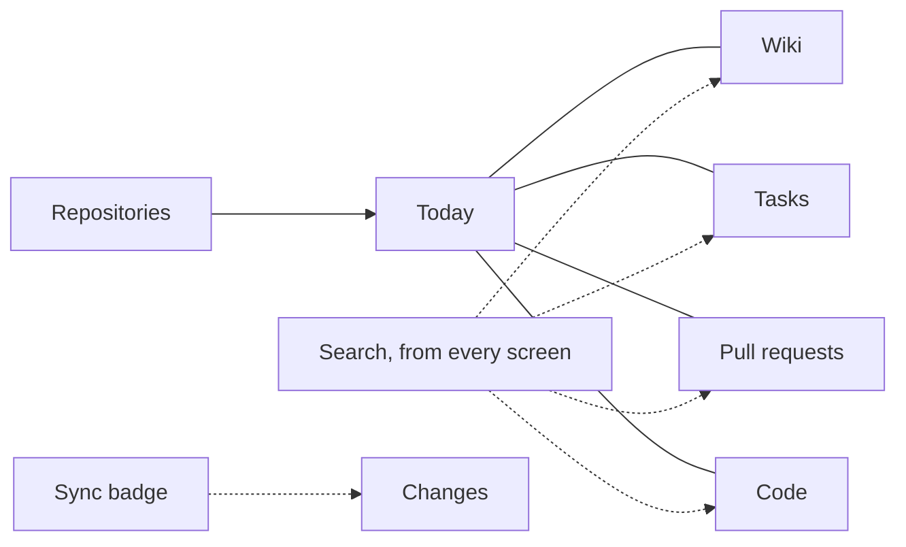

# Experience

What the app does, screen by screen, and what it leaves to the desktop. Tasks for each part are on the board; [[Roadmap]] orders them. [[User stories]] says who does what with it, and what has to be true when each story is done.

[TOC]

## Navigation

- **Repositories** is the start screen: clones on the device, with their branch, unsynced edits and last sync. **Add** clones from a URL, a pasted or scanned `genbeya://` link, or a repository from the forge account you signed in with. **Try the sample project** makes Genbeya's sample repository on the phone, without a remote, to try everything safely.
- **A bottom bar** inside a repository: **Today**, **Wiki**, **Tasks**, **Pull requests**, **Code**. Parts the project doesn't use, or that hide themselves until used (planning, time log, pull requests), are left out as on desktop ([Optional parts](https://github.com/genbeya/genbeya/blob/develop/docs/Design/Optional-parts.md)).
- **Search** sits in the top bar of every screen: one field for pages, tasks, pull requests and files by name, and full text below them. It plays the part of the desktop's `Ctrl+K` palette.
- **The sync badge** in the top bar shows unsynced edits and opens **Changes**.
- **Tablets** show two panes: the list or board on the left, the open page, task or pull request on the right, as the desktop's panels do.

## Today

The screen a repository opens on, and the one thing desktop doesn't have: what needs *you*, computed from the files.

- Tasks assigned to me that aren't done, the ones furthest along first, overdue dates in red and dates within two days in yellow.
- Pull requests waiting for my verdict, and my own with new replies or a request for changes ([[GM-20]]).
- Mentions of my handle (`@ada`, or an alias): others' comments, newest first, then task descriptions and pages.
- Open checklist items with a date (`- [ ] Send the offer 2026-10-12`) in my tasks, or mentioning me in other tasks and pages, soonest first.
- When the clone's identity matches no one, Today says how "me" is found and offers to set the name and email.

"Me" is the person whose Git name or email matches the identity set for the repository ([Writing pages](https://github.com/genbeya/genbeya/blob/develop/docs/Guide/Writing.md#who-is-in-the-list)).

## Wiki

- **The page tree** is a drawer; the current page's place shows as a breadcrumb.
- **Reading** renders pages exactly as the desktop does — references with live titles and states, embeds, callouts, Mermaid, PlantUML, math and plan macros — because it uses Genbeya's own renderer (see [[Architecture#the-web-kit]]). Images and diagrams zoom with a pinch.
- **Tapping a reference** opens the task, page or file; a red one offers to create the page.
- **Checklists** tick while reading, which saves the page, as on desktop.
- **On this page** (a sheet from the top bar) lists the headings.
- **Editing** opens the page's Markdown in the editor with a toolbar above the keyboard: heading, bold, list, checkbox, link, and pickers for `[[` references, `@` people and `//` dates, the same completions the desktop offers. Swipe or tap **Preview** to see the result.
- **Photo** puts a picture or a screenshot into the page: taken or picked, shrunk to 1600 pixels, stripped of location and camera data, its size shown before saving, and written to the wiki's `images/` folder, linked from the page, which renders it as the desktop does ([[Attached images]]). Images in tasks and pull requests come at release, following Genbeya.
- **New** below the current one; moving and renaming pages, with the reference rewrite, come later.

## Tasks

- **The list** is the default on phones: grouped by state, filtered by type, epic, assignee, priority, label and milestone, with the filter chips the desktop's **Filter by** has.
- **The board** shows one column per screen on phones (swipe between columns, a strip at the top shows where you are and how many cards each has) and the whole board on tablets. Long-press a card to drag it onto another column, or onto a state in the strip; released where it started, it offers **Move to…**. In the list, a long press offers **Move to…**. Swimlanes by epic on tablets ([[GM-30]]).
- **A card** shows type, ID, title, assignee, priority, dates, a lock when blocked, the critical-path mark and an open pull request, as desktop cards do.
- **A task** opens full screen: title, then chips for status, type, priority, assignee, epic and labels that open bottom sheets, each saved at once; custom fields below them, edited as desktop edits them (a choice, a number, a date, effort as hours or days, task IDs); the description rendered, with tickable checklist items; **Edit** for the title and the description, which opens in the kit's editor; then **Comments**, **Activity** (from Git history) and, where planning is used, the five numbers, **Blocked by**, **Blocks** and float.
- **Log time** is a bottom sheet: the time spent, what for, and the new remaining effort, filled with the old value minus the time spent.
- **New task** from the board, from a column's "+", from the app icon's quick action, or from text shared into the app from another app (its first line becomes the title). Choosing a type fills the description and presets from its template (`tasks/.templates/<type>.md`) where nothing was written yet; choosing another takes that back, as on desktop.
- **The first edit** of tasks or pages kept with the code asks where the commits go: the checked-out branch, or a branch of one's own, `mobile/<handle>`, to merge later.
- **Comments** have a native composer above the keyboard: typing `@`, `[[` or `//` (or its button) offers people, tasks, pages and files, and dates (`tomorrow`, `fri`, `3d`, a calendar), the same suggestions desktop's editor makes, inserting the same text. Comments are signed with the Git name and the local time with its offset, written in the desktop's exact format; your own are listed under the task with **Edit** and **Delete**.

## Pull requests

Shown once the repository has a pull request file, as on desktop ([Pull requests](https://github.com/genbeya/genbeya/blob/develop/docs/Guide/Pull-requests.md)).

- **The list**: open (with drafts), merged, closed, with open to-dos counted and the filter of the desktop.
- **Conversation**: the branches, commits ahead and behind, each reviewer's latest verdict (approved, stale, changes requested, waiting), **Ready to merge?** condition by condition, the tasks it names, and the file rendered with tickable to-dos.
- **Files**: one file at a time as a unified diff (side by side only on tablets in landscape), with review threads under their lines and outdated ones marked.
- **Comment on lines**: tap a line number, drag to extend the range, then start a topic or add the range to one, with an optional suggestion (edit the lines; the app writes the `diff` block) and an optional to-do.
- **Reply, Approve, Request changes, Withdraw approval, Request review** append the desktop's signed lines, naming the commit the source branch is at.
- **Where replies go**: when pull requests live in the checkout, the file is on the source branch. The app commits onto that branch without switching to it, names it on the button (*Reply on feature/GM-2-git-core*), and pushes it with the next sync, never forced; only branches the remote has.
- **New pull request** from a branch; **Close**, **Reopen**, and **Mark merged** once the target has every commit of the source, after a merge on the desktop or the forge.
- **Merging** and **Clean up…** stay on the desktop in the trial: a merge can stop for conflicts, which a phone is a poor place to resolve.

## Code

- **Files**: the repository's tree, with a filter; recent files first.
- **Viewer**: syntax highlighting, line numbers, find, wrap toggle; Markdown files can switch to the rendered preview. Images show as images.
- **Select lines → Copy reference** puts `[[src/app.ts#L10-L20]]` on the clipboard, ready for a comment or a page. Opening a reference selects its lines; a pinned one (`@v1.0`) opens that revision read-only.
- **Edit** for small changes: the same editor as for pages, with undo, find and replace, and indentation that follows the file. New file, rename and delete.
- Not a mobile IDE: no language servers, no build, no terminal.

## Search

Full text over pages, tasks, pull requests and code, with the matched line in context, grouped by kind. Hidden parts are left out, as on desktop. **Mentions of me** is a shortcut.

## Sync and changes

How a mobile edit reaches everyone else is the part that has to be right; [[Architecture#where-edits-go]] has the mechanics.

- **Every save is a commit** on the device, named as desktop names it (`Update GM-12: Edit tasks`), signed with the repository's Git identity. A phone has no staging step to forget.
- **Sync** fetches, puts local commits on top of what others pushed, and pushes. It runs when you tap the badge, on pull to refresh in any list, and (optionally) a few seconds after an edit, as **Sync automatically** does on desktop.
- **Signing in to push**: a public repository cloned without credentials reads fine but can't push. When the remote asks for credentials, or refuses the token kept for it, Changes and pull to refresh offer **Sign in to push**: a token for the host (with a link to make one on GitHub or GitLab), or signing in with the forge where its OAuth app is set up. The token is kept in the keychain and used for that host from then on.
- **Where commits go**:
  - **The content branch**, for the areas the project keeps there. This is what the content branch was made for, and needs no choice.
  - Otherwise the first edit asks, offering **the checked-out branch**.
  - When the host refuses a push to it (a protected branch), the app offers to move the commits not pushed yet to **a branch of my own** (`mobile/<handle>`), with **New pull request** from it.
- **Changes** lists the unsynced commits and lets you undo the last ones before they are pushed.
- **When two people make the next task** before syncing, both called DM-9, the phone's own moves to the next free ID while it syncs: the teammate's DM-9 stays as it is, and references to it in what the phone wrote (a comment, another new task) follow it. The sync says so.
- **When sync can't finish**, tasks and pull request files are merged the Genbeya way (fields one by one; comments, time log lines and replies both kept, since new ones always go last). If that still conflicts, local commits go to `mobile/rescue/<handle>-<date>`, which is pushed (offline, with the next sync), and the branch is reset to the remote. A banner says which files differ until the desktop has finished the job; once the rescue's commits are upstream, the app offers to delete it. Nothing is ever discarded.

## Sharing and links

- **Copy Genbeya link** and **Copy web link** on pages, tasks, files and pull requests, as on desktop ([Sharing](https://github.com/genbeya/genbeya/blob/develop/docs/Guide/Sharing.md)); the system share sheet sends them.
- **`genbeya://open?…` links** open in the app: the clone with that remote, or an offer to clone it. Parsing follows the desktop's strict rules.

## Signing in

- **HTTPS with a token**, kept in the system keychain (iOS Keychain, Android Keystore).
- **SSH**: the app makes an Ed25519 key on the device, shows the public key to add to the forge, and asks to trust a host's key the first time, showing its fingerprint.
- **GitHub and GitLab sign-in** through the device flow (a code to enter in the browser), as a convenience that ends in a token.
- **Git identity** per repository: name and email, filled from the forge account when there is one.

## Left to the desktop

Terminal; interactive rebase, cherry-pick, revert, stashes, resets; staging hunks and lines; resolving conflicts by hand; WSL and SSH hosts; the settings editor beyond reading (`.genbeya.yml` stays editable as a file in **Code**); generating agent files; merging pull requests and their cleanup. Each can come later if the trial shows it is missed.
